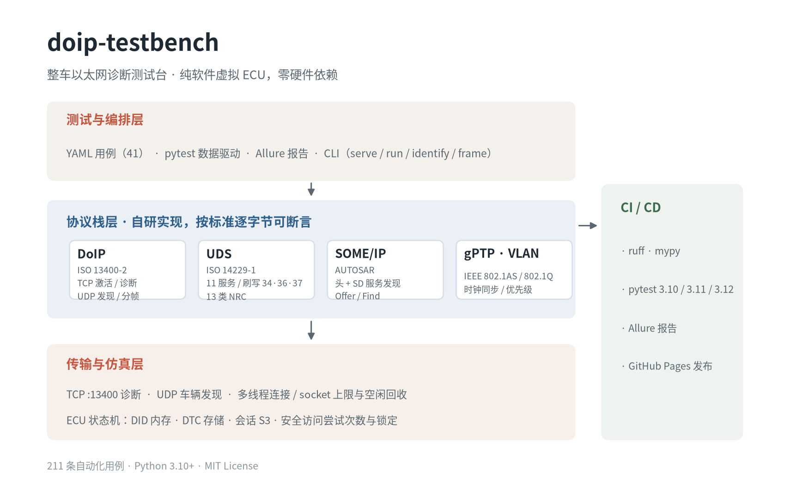

# doip-testbench

用 Python 从零实现的 DoIP 实体（ISO 13400-2）和一个虚拟 ECU，配 213 条自动化用例，外加一个能直接敲命令的交互终端。不需要 CANoe，不需要硬件，clone 下来两分钟能跟一个"车"对话。

  

在线报告：[Allure · 213 passed](https://xgw7117.github.io/doip-testbench/)

## 先看它能干什么

```
$ python tools/uds_shell.py
virtual ECU listening on 127.0.0.1:13400
routing activation accepted. type ? for help, q to quit.

uds> 10 03
  TX  0x8001  0E00 -> 1001  10 03
  RX  0x8002  1001 -> 0E00  accepted
  RX  0x8001  1001 -> 0E00  50 03 00 32 01 F4

uds> flash /tmp/app.bin
flash /tmp/app.bin  4096 bytes  ->  0x0000
[1] 10 02 session   ok
[2] 27 02 unlock    ok
[3] 31 01 FF00      ok
[4] 36 transfer     16/16 blocks  4096/4096 bytes
[5] 37 exit         ok
[6] 31 01 FF01      verify      ok
programmed.
```

一条 `10 03` 走的是完整链路：封成 `0x8001` 发出去，ECU 先回 `0x8002` 确认，再回携带 UDS 应答的 `0x8001`。`flash` 一条命令跑完擦除、下载、传输、校验、复位。



## 它能做四件事

- **被 tester 发现**：UDP 13400 应答车辆识别 / 实体状态 / 电源模式——tester 此时还不知道 ECU 的 IP，广播是唯一的路
- **接受诊断**：TCP 13400 路由激活，UDS 十一个服务，含 `31 01 FF00 → 34 → 36* → 37 → 31 01 FF01 → 11` 完整刷写链路
- **当网关**：按目标逻辑地址转发给下挂 ECU，回程响应改写 SA / TA，未知地址回 `0x8003`
- **当被测对象**：213 条用例直接打它，覆盖 13 类 NRC、超长传输、块计数器乱序、空闲连接回收

## 快速开始

```bash
git clone https://github.com/xgw7117/doip-testbench.git
cd doip-testbench
python3 -m venv .venv
source .venv/bin/activate
pip install -e ".[dev]"
pytest          # 213 passed
```

不需要硬件，也不用 root 或 vcan，测试都在 127.0.0.1 的临时端口上跑。

跑完想自己敲几条，用交互终端：

```bash
python tools/uds_shell.py                    # 起一个虚拟 ECU 并连上去
python tools/uds_shell.py --host 169.254.1.1 # 连一台已经在跑的 ECU
```

## 交互终端

| 输入                          | 作用                                            |
| --------------------------- | --------------------------------------------- |
| `10 03`                     | 发任意 hex 报文，收发都打印到帧层（0x8001 / 0x8002 / 0x8003） |
| `flash <file> [addr]`       | 走完整刷写序列，默认地址 0                                |
| `unlock`                    | `27 01` → 算 key → `27 02`，一次做完                |
| `ver`                       | 比对密钥版本：ECU 侧 vs 本地                            |
| `disc` / `status` / `alive` | DoIP 车辆识别 / 实体状态 / Alive Check                |
| `frame 4003`                | 发任意 DoIP 载荷类型                                 |

终端在后台每 2 秒发一次 `3E 80` 保活。没有它，人工操作超过 S3（5 s）会话就掉回默认、安全状态一并清除，`27 02` 会莫名返回 `7F`——看起来像 key 算错，其实是会话没了。

不写代码也能跑 YAML 用例，它自己起一个 ECU 再自己打：

```bash
doipbench run tests/data/uds_cases.yaml --start-ecu --port 0
```

## 实现范围

| 协议                         | 做了什么                                                                                                                |
| -------------------------- | ------------------------------------------------------------------------------------------------------------------- |
| DoIP over TCP（ISO 13400-2） | 8 字节头解析与组帧、路由激活、诊断消息、**诊断消息确认（0x8002）**、Alive Check、0x8001 / 0x8003；按目标逻辑地址转发（网关模式）                                 |
| DoIP over UDP（ISO 13400-2） | 车辆识别（0x0001 / 0x0002 / 0x0003）、实体状态、电源模式；TCP 专属报文走 UDP 一律回 generic NACK 0x01                                        |
| UDS（ISO 14229-1）           | 0x10 会话、0x27 安全访问、0x22 读数据、0x2E 写数据、0x19 读 DTC、0x3E 保持连接；0x34 / 0x36 / 0x37 刷写数据传输、0x31 擦除与 CRC 校验、0x11 复位；13 类 NRC |
| SOME/IP                    | 头部和 SD 报文的编解码，**没有做服务端**                                                                                            |
| gPTP / VLAN                | IEEE 802.1AS 头部解析、802.1Q 标签                                                                                         |
| ISO-TP（ISO 15765-2）        | 分段和重组，用于理解 CAN 侧的长报文传输                                                                                              |

## 三个刻意的设计选择

**1. 0x8002 的 SA 填自己，不填请求里的目标地址。**

收到 `0x8001` 后要回一帧确认，很多人照抄请求的地址顺序，结果 tester 把它当非预期报文丢掉。正确方向是 **SA = 本机实体地址，TA = tester**。

**2. 网关后面的节点不回 0x8002。**

只有 tester 直连的边缘节点才回。网关下挂的内部节点也回的话，tester 会收到两份确认，P6 计时被搅乱。所以这是配置项 `ack_diagnostic_messages`，不是无条件发送。

**3. 服务端不做 S3 保活。**

ECU 只在"5 秒没收到任何请求"时退回默认会话，这是防止 tester 崩溃后一直停在编程会话、保持解锁状态。保活是 tester 的责任（周期发 `3E 80`），不是 ECU 的。

## 测试

一共 213 条，跑完 `pytest` 的最后一行就是这个数：

| 层     | 条数  | 测什么                                                    | 位置                   |
| ----- | --- | ------------------------------------------------------ | -------------------- |
| 单元    | 114 | 编解码、状态机、YAML 加载器，不碰网络                                  | `tests/unit/`        |
| 协议一致性 | 85  | UDS 服务用例（YAML 数据驱动）、TCP 报文用例、UDP 报文用例、0x8002 确认的正反两个方向 | `tests/conformance/` |
| 端到端   | 14  | 会话切换、安全锁定、两个 tester 同时连接、网关转发                          | `tests/functional/`  |

GitHub Actions 上用 Python 3.10 / 3.11 / 3.12 各跑一遍。

用例写在 `tests/data/uds_cases.yaml`，加一条不用改代码：

```yaml
cases:
  - id: UDS-WDBI-002
    title: Write is rejected in the default session
    request: "2E 01 00 11 22 33 44 55 66 77 88"
    expected_nrc: 0x7F
    tags: [wdbi, negative]
    severity: critical
```

注意 `-` 要缩进到 `cases:` 底下。顶格写成纯列表，加载器会直接报  
`CaseSchemaError: expected a mapping with a 'cases' list`。

## 目录

```
src/doipbench/
├── doip/         帧解析、服务端、客户端
├── uds/          十一个服务、会话与安全状态机
├── someip/       SOME/IP 头 + SD
├── net/          VLAN、gPTP
├── transport/    ISO-TP
├── testing/      YAML 用例加载
├── config.py     ECU 配置
└── cli.py        serve / run / identify / frame
tools/
├── uds_shell.py  交互式诊断终端
├── interop_check.py  用第三方库对打自己的服务端
└── check.py      源码一致性检查
tests/
├── unit/         单元测试
├── conformance/  协议一致性
├── functional/   端到端
└── data/         YAML 用例
```

## 已知限制

- 没有和真实 ECU 对接过。这台"车"是纯软件。
- 安全访问用的是 `SHA-256(secret ‖ seed)` 拼接派生。这个构造有长度扩展风险，生产环境应改 HMAC-SHA256 或 AES-CMAC。`SecurityConfig.key_version` 经 DID `0xF1A0` 公布，tester 启动时比对，版本不一致会直接报出来，而不是回一个看不出原因的 `0x35`。
- 刷写数据只落在内存里一块 `flash_size` 的缓冲区，**断电即丢**。指纹写入、刷写依赖检查、段地址映射、NVM 持久化都没做，所以它不是能刷真 ECU 的刷写器。
- 网关是**进程内的逻辑地址路由**：按目标地址把请求分发到下挂的 UDS 实例，不是真的两跳网络。DoIP 的 entity 多跳（跨 entity 转发）没做。
- Alive Check 只做被动的 `0x0007 → 0x0008` 应答，不主动发探活包。
- 空闲连接靠 `inactivity_timeout`（默认 300 s，`None` 关闭）回收——拔线 / 掉电的 tester 不会发 FIN 或 RST，否则只能等内核重传耗尽（约 15 分钟），期间一直占着 `max_concurrent_sockets` 的名额。
- UDP 只放发现类报文。诊断和 Alive Check 只能走 TCP，往 UDP 上发会收到 generic NACK——不是没实现，是标准不允许。
- 网关模式没有 CLI 开关，要在代码里传路由表：

```python
from doipbench.config import default_config
from doipbench.doip.server import DoIPServer

config = default_config(routing_table={0x1000: "gateway", 0x1010: "ecu_a"})
with DoIPServer(config, port=13400) as server:
    ...  # 发到 0x1000 由网关自己答，发到 0x1010 转给 ecu_a，其他地址回 0x8003
```

## 密钥管理

真车上没有人"知道"密钥。ECU 侧烧进 HSM / SHE 的密钥槽，写入后读不出来；tester 侧是 OEM 发的 `SeedKey.dll`，算法可调用、密钥不可见。两边靠**密钥版本号**对齐，不靠人记。

本项目实现了版本号这一层：`SecurityConfig.key_version` 经 DID `0xF1A0` 公布，`uds_shell` 启动时读一次，对不上就打印 `key version: ECU v2, local v1  MISMATCH`。

HSM、SeedKey DLL、密钥派生与轮换、解锁审计日志都没做，这些属于密钥管理系统（KMS），不在一个诊断测试台的范围内。

## 参考标准

- ISO 13400-2 — DoIP
- ISO 14229-1 — UDS
- ISO 15765-2 — ISO-TP
- AUTOSAR SOME/IP Protocol Specification
- IEEE 802.1AS / 802.1Q

## License

MIT
