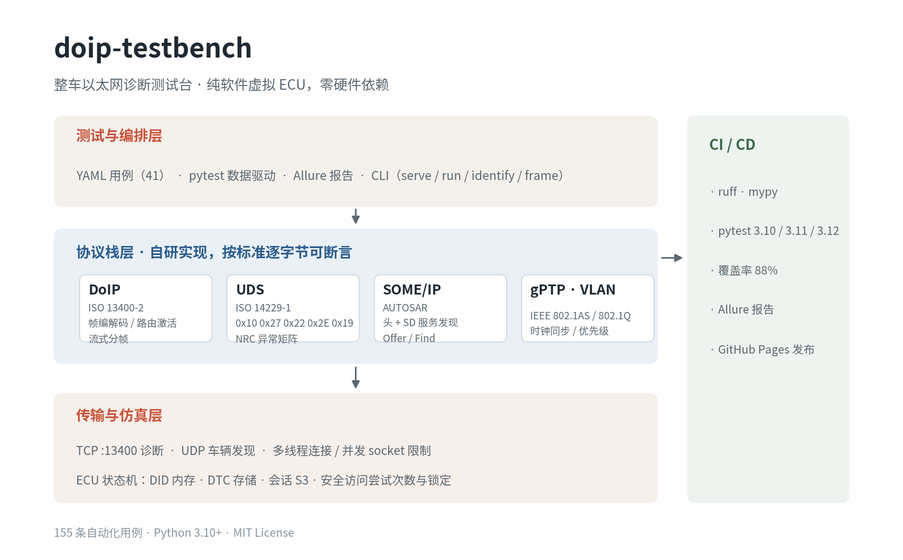
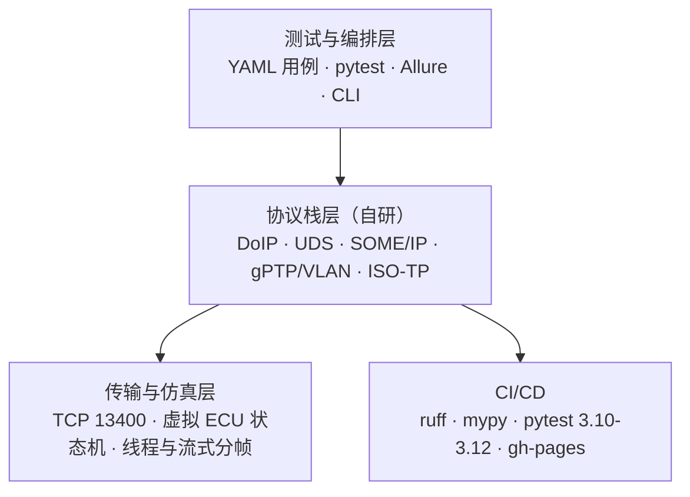

# doip-testbench

> 车载以太网诊断测试台：纯 Python 实现的 DoIP / UDS 协议栈 + 虚拟 ECU，无需 CANoe、无需硬件，`pytest` 一条命令跑通诊断闭环。

[](https://github.com/xgw7117/doip-testbench/actions/workflows/ci.yml)
[](https://www.python.org)
[](LICENSE)
[](tests)
[](tests)



---

## 为什么做这个项目

诊断测试的常规做法是「真实 ECU + CANoe + VN 硬件」，代价是设备排队、环境难复现、CI 里跑不了。
这个项目把**被测对象**和**测试工具**都放进同一个仓库：

| 角色 | 实现 |
| --- | --- |
| 被测 ECU | `DoIPServer` + `UdsServer`：监听 TCP 13400，维护 DID / DTC / 会话 / 安全状态 |
| 测试工具 | `DoIPClient`：路由激活、诊断消息收发、超时与 NACK 处理 |
| 测试用例 | YAML + pytest 参数化，41 条服务用例不改一行代码即可扩展 |
| 回归入口 | `pytest` / `doipbench run`，GitHub Actions 三版本矩阵 |

结果：**155 条用例、88% 分支覆盖、CI 单次运行约 6 秒**，任何一次提交都能证明协议行为没有退化。

## 核心能力

| 协议 / 标准 | 覆盖内容 |
| --- | --- |
| **DoIP**（ISO 13400-2） | 8 字节头编解码、车辆识别（0x0001–0x0004）、路由激活（0x0005/0x0006，含拒绝码 0x00–0x06）、Alive Check、实体状态、电源模式、诊断消息 0x8001/0x8002/0x8003、Generic NACK |
| **UDS**（ISO 14229-1） | `0x10` 会话控制（P2/P2\* 编码）、`0x27` 安全访问（seed/key、错误计数、锁定窗口）、`0x22` 多 DID 读取、`0x2E` 写入、`0x19` DTC（数量 / 列表 / 快照 / 扩展数据 / 状态掩码过滤）、`0x3E` 保活 |
| **TCP 分帧** | 粘包、拆包、逐字节传输；长度字段与 `max_payload_size` 校验 |
| **SOME/IP**（AUTOSAR） | 16 字节头、Request/Response/Error、SD 服务发现（Offer/Find/Subscribe 条目、IPv4 Endpoint Option） |
| **gPTP / VLAN** | IEEE 802.1AS 公共头（Sync/Follow_Up/Announce）、correctionField 换算；802.1Q PCP/DEI/VID 解析与封装 |
| **ISO-TP**（ISO 15765-2） | 单帧 / 首帧 / 连续帧 / 流控帧，序列号回绕与重组校验（面向 CAN 网关场景） |
| **工程化** | 类型注解 + mypy strict、ruff、Allure 报告、GitHub Actions、gh-pages、CLI |

## 快速开始

```bash
git clone https://github.com/xgw7117/doip-testbench.git
cd doip-testbench
python -m venv .venv && source .venv/bin/activate
pip install -e ".[dev]"
pytest                       # 155 passed
pytest --cov=doipbench       # 覆盖率 88%
```

不需要硬件，也不需要 root 或 vcan。所有测试在 `127.0.0.1` 的临时端口上完成。

### 当成工具用

```bash
# 1. 启动虚拟 ECU
doipbench serve --port 13400

# 2. 另一个终端：读取车辆识别信息
doipbench identify --port 13400

# 3. 跑 YAML 用例（自带 ECU，随机端口）
doipbench run tests/data/uds_cases.yaml --start-ecu --port 0

# 4. 离线解析一帧 DoIP（排查抓包时很好用）
doipbench frame "02 FD 80 01 00 00 00 06 0E 00 10 01 10 03"
```

```text
protocol version  0x02
payload type      0x8001 (DIAGNOSTIC_MESSAGE)
payload length    6
payload           0E 00 10 01 10 03
  source address  0x0E00
  target address  0x1001
  UDS              10 03
```

## 测试设计

三层结构，职责分明：

| 层级 | 数量 | 关注点 |
| --- | --- | --- |
| 单元测试 `tests/unit` | 77 | 编解码、状态机、YAML schema、CLI，不碰 socket |
| 一致性测试 `tests/conformance` | 68 | 41 条 UDS 服务用例（YAML 驱动）+ 27 条 DoIP 协议一致性用例 |
| 功能测试 `tests/functional` | 10 | 闭环流程、S3 超时、安全锁定、双 Tester 并发、udsoncan 互操作 |

### 用例长什么样

```yaml
- id: UDS-WDBI-003
  title: Write without security access yields 0x33
  request: "2E 01 00 11 22 33 44 55 66 77 88"
  expected_nrc: 0x33
  precondition:
    session: 0x03
  tags: [wdbi, security, negative]
  severity: blocker
```

加载器在收集阶段就校验 schema：重复 ID、非法 hex、缺少期望值都会直接报错并指出用例 ID，而不是等到断言时才失败。

完整清单见 [docs/test-matrix.md](docs/test-matrix.md)（自动生成），协议实现细节与常见坑见 [docs/protocol-notes.md](docs/protocol-notes.md)。

### 一份 NRC 覆盖清单

| 服务 | 正例 | 覆盖的 NRC |
| --- | --- | --- |
| 0x10 | 默认 / 扩展 / 编程 / 抑制位 | `0x12` `0x13` |
| 0x27 | seed、解锁、重复请求返回全 0 seed | `0x24` `0x35` `0x36` `0x37` `0x7F` |
| 0x22 | 单 DID、多 DID、会话 DID | `0x13` `0x31` |
| 0x2E | 写入后回读比对 | `0x13` `0x31` `0x33` `0x7F` |
| 0x19 | 数量 / 列表 / 快照 / 扩展 / 掩码过滤 | `0x12` `0x13` `0x31` |
| 其他 | 未知服务、TesterPresent | `0x11` `0x12` |

## 架构



```text
src/doipbench/
├── doip/          # 帧编解码、流式解析器、服务端、客户端
├── uds/           # 5 大服务 + NRC、会话/安全状态机、udsoncan 适配器
├── someip/        # SOME/IP 头 + SD 服务发现
├── net/           # 802.1Q VLAN、802.1AS gPTP
├── transport/     # ISO-TP 分段与重组
├── testing/       # YAML 用例加载与 schema 校验
├── config.py      # ECU 配置（VIN、DID 表、DTC 表、时序参数）
└── cli.py         # serve / run / identify / frame
```

## 几个关键设计决策

**1. 自研协议栈，而不是直接包一层 `udsoncan`**
只有自己实现才能对「路由激活前发诊断消息应回 0x8003 / NACK 0x02」这类字节级行为做断言。
同时提供 `uds/udsoncan_connector.py`（40 行）让 `udsoncan` 直接复用本项目的 DoIP 传输，既证明协议实现正确，也证明接口抽象干净。

**2. 把 TCP 当成流，而不是消息**
`DoIPFrameParser` 维护缓冲区，按 `payload length` 切帧，支持任意切分方式。套件里专门有三条用例：粘包（两帧一次发）、三段拆包、逐字节发送。

**3. 每个连接一个 UDS 会话，整套 ECU 共享一份状态**
真实 ECU 支持多个 tester 同时连接，会话互相独立，但 DID / DTC 是同一份。
因此 `UdsServer` 按连接创建，`EcuState` 全局共享并加锁。测试里用两个不同源地址的 tester 验证了这一点。

**4. 错误响应严格分层**
- 头/负载格式错误 → Generic NACK（0x0000，带原始 payload type）
- 诊断消息的目标地址、源地址、长度错误 → 诊断 NACK（0x8003）
- UDS 服务层错误 → `0x7F SID NRC`

这三类混用是 DoIP 实现里最常见的 bug，套件对每一类都有独立断言。

**5. 安全访问按真实 ECU 的行为建模**
seed 每次递增且不可预测、错误 key 计数、达到上限后进入锁定窗口并返回 `0x36`，窗口内请求返回 `0x37`，超时后恢复。测试用 0.5 s 的锁定时长把这条链路完整跑了一遍。

## CI / CD

`.github/workflows/ci.yml`：

- `quality`：`ruff check` + `ruff format --check` + `mypy`
- `test`：Python 3.10 / 3.11 / 3.12 矩阵，`pytest --cov`，上传 Allure 原始结果与覆盖率
- `report`：合并 Allure 结果、生成静态报告并发布到 GitHub Pages

Allure 报告按 `feature / story / severity / tag` 组织，用例 ID 与 YAML 一一对应，失败时能直接定位到哪一条服务、哪一个 NRC。

## Roadmap

- [ ] DoIP 2019 版（协议版本 0x03）与 VIN/GID 同步状态
- [ ] 诊断消息 ACK（0x8002）与可配置的 `A_DoIP_DiagnosticAck`
- [ ] SOME/IP-SD 状态机（Offer 周期、TTL 过期、Eventgroup 订阅）
- [ ] gPTP 主从时钟偏移计算与 TSN 门控（802.1Qbv）配置校验
- [ ] 可选的真实网卡模式（AF_PACKET），把同一套用例跑到硬件上

## 参考标准

- ISO 13400-2:2019 — Diagnostic communication over Internet Protocol (DoIP)
- ISO 14229-1:2020 — Unified diagnostic services (UDS)
- ISO 15765-2:2016 — Diagnostic communication over CAN (ISO-TP)
- AUTOSAR PRS SOME/IP Protocol Specification
- IEEE 802.1AS / 802.1Q
- OPEN Alliance TC8 — Automotive Ethernet ECU Test Specification

## License

[MIT](LICENSE)
